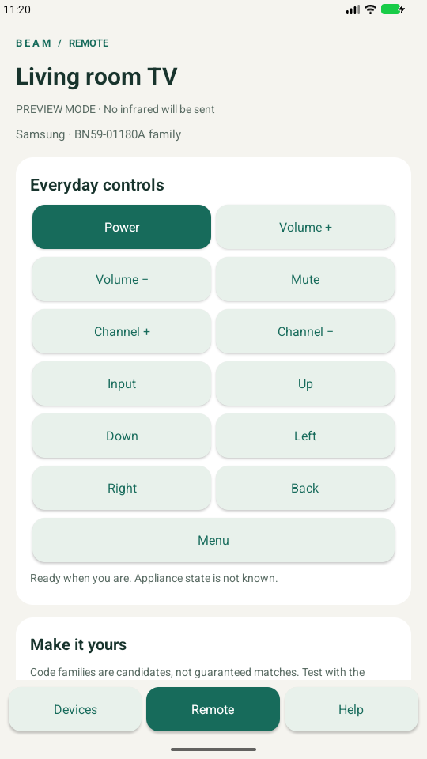

# Beam Remote

An ad-free native Android infrared remote MVP for TVs and air conditioners, built with AI as a development partner. It uses your phone’s built-in IR blaster through Android’s public `ConsumerIrManager` API.

**No ads, accounts, analytics, or internet permission.** Android 6.0 / API 23 or newer. The project is at version **1.1.0** and is licensed under [MIT](LICENSE).



## Try the app

Download the development APK from [Releases](https://github.com/wstrhwkdnd-afk/beam-remote/releases), then follow the [installation and first-test guide](docs/INSTALL.md). For an Android Studio project, clone the repository or use **Code → Download ZIP**.

A real Android-accessible IR emitter is required for appliance control. Phones without one can explore the interface in Preview. A successfully sent signal does not prove the appliance received it.

## Device coverage

All built-in families below are **candidates requiring verification on your hardware**.

| Device | Candidate family | Controls |
| --- | --- | --- |
| Samsung TV | BN59-01180A family | Power, volume, mute, channel, input, navigation, back, menu |
| LG TV | NEC address 04 | TV controls including OK |
| LG AC | LG28 / 6711A20083V; LG2 / AKB75215403 | Power, 16–30°C, mode, fan |
| Whirlpool AC | DG11J1-3A / 04 | 18–32°C, mode, fan, separate power toggle |
| Whirlpool AC | DG11J1-91 | 16–30°C, mode, fan, separate power toggle |
| Other devices | Custom raw codes / complete AC scenes | User-supplied commands |

**Whirlpool DG11J1-35 compatibility is unverified.** It is not listed as supported merely because it shares the Whirlpool brand or a similar remote-model name. Contributions with receiver captures and physical test results are welcome.

## Open and run

1. Open this folder in a current Android Studio version supporting Android Gradle Plugin **9.4.1**.
2. Install **Android SDK Platform 37.0** and **Build Tools 36.0.0** through SDK Manager. Use Android Studio's bundled JDK (JDK 17+; this project was built with its bundled runtime).
3. Let Gradle sync. The checked-in wrapper downloads **Gradle 9.8.1** and verifies the distribution checksum. Android Studio creates `local.properties` for your SDK path; this file is machine-specific.
4. Select the `app` configuration and your phone, then Run. Enable USB debugging on the phone and accept its debugging prompt.
5. Add a device. Pick a remote-code family, point the phone's IR window at the appliance, and test one command. Check Help to see hardware capabilities and the Preview switch.

Command line, with `JAVA_HOME` set to a compatible JDK and `ANDROID_HOME` or `local.properties` pointing at the SDK:

```sh
./gradlew assembleDebug testDebugUnitTest lintDebug
adb install -r app/build/outputs/apk/debug/app-debug.apk
```

Windows: use `gradlew.bat`. A debug APK is for testing; production distribution requires your own release signing setup. The pinned Gradle distribution is checksum-verified. With Android command-line tools, the platform package is `platforms;android-37.0`.

[GitHub Actions](https://github.com/wstrhwkdnd-afk/beam-remote/actions/workflows/android.yml) runs the build, JVM tests and lint on pushes and pull requests, and keeps the debug APK and reports as workflow artifacts. Hardware compatibility tests remain separate.

## Included in the MVP

- Multiple named device profiles, stored locally; select, rename, delete, import and export.
- Samsung TV BN59-01180A-family candidate: power, volume, mute, channel, input, navigation, back and menu. No unverified Samsung OK code is supplied; add a captured command if needed.
- LG TV NEC-address-04 candidate, including OK. A code family does not imply every model is supported.
- LG AC LG28 / 6711A20083V and LG2 / AKB75215403 candidates: explicit off, on/apply, 16–30°C, mode and fan. Draft settings persist; changing them never sends automatically.
- Whirlpool AC DG11J1-3A/04 (18–32°C) and DG11J1-91 (16–30°C) candidates: Cool/Dry/Fan/Heat, Auto/Low/Medium/High fan, Apply settings and a separate transient Power on/off toggle. Heat needs a heating-capable unit. Advanced 6th Sense, swing, sleep, turbo and timers are not included.
- Custom TV buttons and custom AC **complete-state scenes** using raw microsecond patterns. This provides a practical path for other brands without pretending they share an AC protocol.
- `ConsumerIrManager` transmission off the UI thread, carrier-range checks where the OEM reports them, validation below Android's two-second limit, error reporting, and dropped rapid taps rather than an unbounded command queue.
- Preview mode automatically defaults on when there is no accessible emitter. Preview never transmits; transmission is never reported as appliance confirmation.
- Native scrollable screens, large labeled buttons, system font scaling, system-bar insets, and accessibility announcements for command results.

## Coverage and limits

This is an extensible MVP, **not an exhaustive universal code database**. Presets are protocol/code candidates and have not been verified on your appliances. TV and Whirlpool AC power are toggles; AC state is only the desired state, not telemetry. No automatic code scanning, learning, Bluetooth/RF/Wi-Fi control, macros, press-and-hold repetition, swing, AC timers, or cloud database is included. The UI is English-only.

The phone model is not needed to build or browse the app: it probes Android's public IR API at runtime. A physical emitter hidden behind a vendor-only API will appear unavailable. If a command fails on real hardware, record the phone model, Android version, appliance model, and original remote model using the testing checklist.

Profiles are local app data; uninstalling or clearing storage removes them. Export important profiles first. Device transfers may be affected by Android/OEM backup policy. Imports create new profile IDs and never overwrite another device. File transfers are bounded at 512 KB; 50 devices and 64 commands per device are supported. Raw signals are limited to 4,096 durations and less than two seconds.

If an import is interrupted by activity destruction while a slow document provider is reading, retry the import; existing profiles are preserved. The app deliberately avoids background signal queues and automatic retries because repeated power commands can undo the intended action.

## Project map

- `MainActivity.java`: native screens, profile editing and Android document picker.
- `Profile.java`, `ProfileStore.java`, `Catalog.java`: schema validation, local persistence and candidate families.
- `Signal.java`, `Encoders.java`, `WhirlpoolEncoder.java`: bounded raw signals and Samsung/NEC/LG/Whirlpool wire formats.
- `IrTransmitter.java`: public Android IR API adapter and serialized transmission.
- `app/src/test/`: protocol vectors, boundary validation, and profile round-trip tests.
- [Hardware and test checklist](docs/TESTING.md)
- [Protocol references and extension guide](docs/PROTOCOLS.md)
- [Profile format](docs/PROFILE_FORMAT.md)

Android's [ConsumerIrManager documentation](https://developer.android.com/reference/android/hardware/ConsumerIrManager) defines the transmit API and its limits. Protocol-specific research links are recorded in the protocol guide.

## Whirlpool quick start (v1.1.0)

Install the updated APK over the existing debug app to keep saved profiles. Choose **Add device**, then **Whirlpool AC · DG11J1-3A / 04** or **Whirlpool AC · DG11J1-91**, matching the model printed on the original remote. Both are candidates, not a guarantee for every Whirlpool AC.

Choose temperature, mode and fan, then tap **Apply settings**. This does not toggle power. Tap **Power on/off (toggle)** once when you want to switch power. Repeated power taps can undo each other; the app cannot read the appliance's current state. The last-changed setting determines the command category while each frame carries all basic settings. These basic frames carry timers and advanced-feature flags off; use captured custom scenes if those features are needed. Importable examples are in `examples/whirlpool-3a-ac.json` and `examples/whirlpool-91-ac.json`.


## Contribute

See [CONTRIBUTING.md](CONTRIBUTING.md) for development and device-profile contributions. When reporting compatibility, include the phone/Android version, appliance model, original remote model, chosen profile and actual observed response. Avoid publishing phone serial numbers or private exported profiles.

## License and acknowledgments

Original code and documentation: [MIT License](LICENSE). Gradle wrapper assets retain their Apache 2.0 license. See [THIRD_PARTY_NOTICES.md](THIRD_PARTY_NOTICES.md) for build/test dependencies and protocol-research references.

This is a personal community project, with no affiliation to the appliance or phone manufacturers named above.
