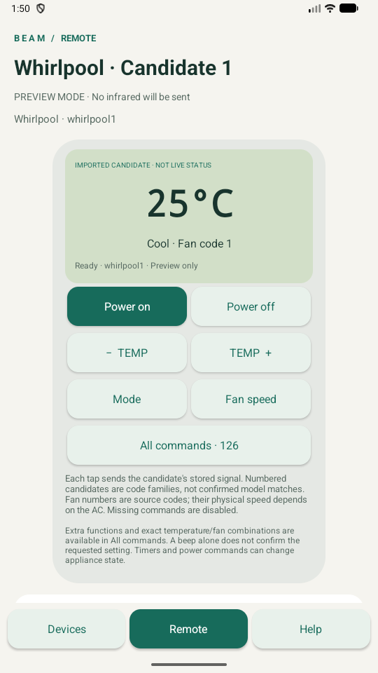

# Offline profile libraries (v1.3.0)

Beam Remote can load an optional `.beamzip` library containing multiple brands and candidate profiles. The APK itself contains no downloaded third-party profile database and still needs no internet permission.

## Use a library

1. On **Devices**, choose **Import profile library** and select the file.
2. Choose a brand (or search by name), then a numbered candidate.
3. The candidate opens for testing without saving it. Opening, importing, switching candidates and restoring screens never transmit IR.
4. Keep Preview enabled for initial inspection. To test the AC, turn Preview off in Help, point the phone at the AC and tap one command. The app does not confirm reception.
5. Scroll to **Save this remote** after confirming the functions you need. Use **Try next candidate** if it does not match. Nothing is automatically scanned or transmitted.

The candidate number is an inventory identifier, **not an appliance or original-remote model number**. Test power, temperature, mode, fan and each extra function separately. Power buttons may contain toggle codes even when the source calls them On/Off. Observe the AC before repeating.

The remote exposes stored power codes, temperature steps and mode/fan changes where exact commands are available. Missing combinations are disabled. **All commands** provides a searchable list including timer, swing, sleep and special-function codes when present. Fan labels show the original source code rather than inventing a physical speed mapping. Selecting an entry sends that stored command once. The display shows requested settings, never actual appliance state.

An invalid command produces an error without transmitting or changing the requested settings. Basic controls do not synthesize absent signals. State-shaped commands (such as `C24F1`) update the requested display; arbitrary named commands do not imply a known resulting state.

## Saved devices and transfers

A saved library device references its library by SHA-256 and profile entry. Reimporting a different library cannot silently change that device's codes. Up to five distinct libraries can be retained; each library is limited to 64 MiB compressed and 256 MiB expanded. The existing 50-saved-device limit applies to your saved devices, not the number of candidates in a library.

Exporting a saved device exports its settings/reference only. To use it on another phone, import the **same library file** there before importing the saved-device JSON. Clearing app data or uninstalling removes private libraries and profiles; keep your source library file and device exports. Test sessions are not saved across app recreation until you explicitly save the remote.

## Format for contributors

A library is a ZIP with `index.json` and profile JSON entries; entries are read directly rather than extracted. Archive paths, duplicates, compressed/expanded sizes, JSON sizes and item counts are bounded.

```json
{
  "format": "beam-profile-library",
  "version": 1,
  "source": "Your catalog and provenance",
  "brands": [{
    "id": "example",
    "name": "Example",
    "profiles": [{
      "id": "example1",
      "name": "Candidate 1",
      "entry": "profiles/example/example1.json"
    }]
  }]
}
```

Each profile includes `brand`, `model`, optional `profileId`, optional `timing` (default `pronto`), `metadata`, and a `commands` object mapping labels to raw Pronto strings. Metadata may include `degree_type` (C/F), `min_degree`, `max_degree`, `max_fan_power` and comma-separated `modes` (C cool, H heat, W fan, D dry, A auto). Missing metadata does not establish physical capabilities. Model-dependent special functions stay named commands. The parser accepts punctuation in bounded, non-control command names.

Standard `pronto` accepts only raw type `0000`, uses the carrier period `frequencyWord × 0.241246 µs`, validates declared intro/repeat pair counts, and sends the complete listed sequence once. It rejects invalid hexadecimal words, empty/zero-duration signals and signals outside Android bounds. It never repeats a sequence automatically.

`acremote26` is an explicit compatibility convention observed in AcRemote 3.5: carrier is truncated from the same formula, each listed duration count is multiplied by 26 µs, and declared intro/repeat pair counts are ignored. The complete remaining sequence is sent once. This reproduces the inspected sender's timing convention rather than silently interpreting these data as strict Pronto. All actual duration/carrier/pattern bounds still apply. Use this convention only for data requiring it.

Library limits: 1,000 brands, 20,000 profiles, 50,000 ZIP entries, 2 MiB index, 4 MiB per profile and 2,048 commands per profile. Individual signals retain the 4,096-duration and less-than-two-second limits.

## AcRemote 3.5 investigation

The user-owned installation of `com.universal.ac.remote.control.air.conditioner`, version 3.5 (62), was inspected with REA/JADX. The complete base/split APK set was copied read-only; AcRemote was not modified, patched or uninstalled. Static code inspection established a brand catalog, on-demand brand packs, per-profile JSON command maps, and the sender's timing convention. Native key-handling disassembly used the locally available LLVM tool because REA's optional native providers were unavailable. Static observations are not a runtime or authenticity certification.

The inspected dedicated Gree, LG and Samsung screens route the selected profile path through the same JSON command-map loader. Their entry/load/mode paths did not reveal an additional dataset or generated protocol family. This bounds the inventory claim to the listed downloadable catalog, rather than all possible app functionality.

Inventory of the listed packs retrieved on 20 October 2026:

- **86 brands; 266 candidate profiles**. All 86 listed packs were retrieved successfully. This is the catalog exposed by the inspected version, not proof that every profile available in every app version or server location was found.
- **30,596 distinct command entries**, after matching the source's last-entry-wins handling of 32 duplicate key rows.
- **30,590 commands decode within Beam Remote's signal bounds**. This does not establish appliance compatibility.
- Six commands are blocked individually: `aoli1/WF1` (only two durations), `electra2/DOUBLE_CODES`, `gree5/WF4`, `vestel2/WF1` (empty), `panasonic5/C24F2` (zero duration), and `shuaikang1/H27F4` (malformed hexadecimal word).
- 5,524 entries have header-count differences handled by the explicit compatibility convention above.
- Whirlpool has five numbered candidates. No exact DG11J1-35 model association was established. These profile files do not supply a named 6th Sense command; Beam Remote's existing experimental basic 6th Sense encoder remains separate.

The downloaded catalog was prepared as a **local personal library**. It is not included in this repository, APK or public release assets, and is not relicensed under MIT. Public code includes the library reader, controls and synthetic tests. Third-party packages/data retain their original rights and provenance.

### Evidence ledger

- Installed-package resolution: `ev_466ba51f553a62bb8d6b5d475b3b81f655706a53574f06ff9cc7dd44f4048d4b`.
- APK metadata summary: `ev_42a25f2c578416cb1c3cd071621b3fda6904e08e1b6c5c453183f6b90f7610da`; base APK SHA-256 `801fe339e4587077687e1aa038273150353d383862caaeace07a6421d0ba683e`.
- Profile lookup/normalization (`k9.j`): `ev_8017c417d8d07f541bec61a00654eab46c2c481afda72b44c46a9cb49f120854`.
- Download selection (`TestActivity.q`): `ev_a0e02a96a7dcee13746827c1ba0460b91c4132da397fb4838d835e9ac15dacd6`.
- Signal conversion (`sp.x`): `ev_526d431ccbc0b64c4fd20e50564bda3fdd8be93945f6bf7f8286ad640583907b`.
- Specialized-screen routing/shared loader: `ev_76477d789b387da0ee1f6370877a66a6e66da60660fcc7c552848b7beae0a8d0`, `ev_60b94b3f70eedd27ad5f86aa085359e7c251de90ad4614c8e17238109da4a5f9`, `ev_d34981c4fad1fef21b4f3ba17ade5abeac8edb485f3efaca36bee1e4fbed4e2f`.
- These are static REA observations. Archive enumeration, catalog counts and full-library validation are separate local acquisition/parser observations. No paid features, account credentials or private account data were acquired.


